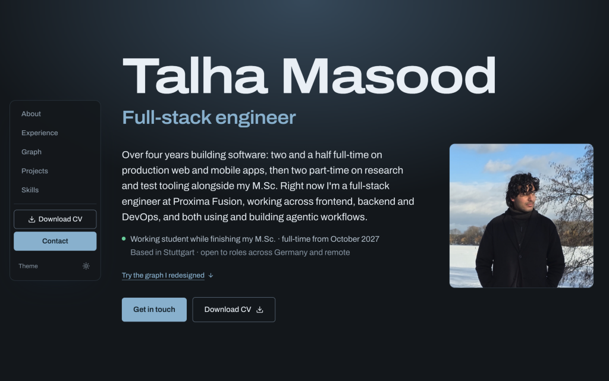

# Talha Masood — Portfolio

Personal portfolio for Talha Masood, full-stack software engineer.

**Live site:** [https://talhamasood.dev](https://talhamasood.dev)

[](https://talhamasood.dev)

## Tech Stack

- **Framework:** Next.js 16 (App Router), React 19, TypeScript
- **Styling:** Tailwind CSS v4
- **Interactive Graph:** React Flow (`@xyflow/react`) & Dagre (`@dagrejs/dagre`)
- **Icons:** Lucide React & Simple Icons
- **Hosting & Analytics:** Vercel & Vercel Analytics

## Local Development

```bash
npm install
cp .env.example .env.local
npm run dev
```

Open [http://localhost:3000](http://localhost:3000).

### Scripts

```bash
npm run build      # Production build
npm run lint       # ESLint
npm run test:e2e   # End-to-end static checks
```

### Deployment

The site deploys on [Vercel](https://vercel.com) from this repository: every push to `main` ships to production, and other branches get preview deployments. The custom domain `talhamasood.dev` is attached under **Settings → Domains** in the Vercel project, with its DNS pointing at Vercel.

To check a production build locally before pushing:

```bash
npm run build && npm run start
```

### Environment Variables

Set these in `.env.local` for local development or in Vercel (**Settings → Environment Variables**) for production (`NEXT_PUBLIC_*` values are baked in at build time):

| Variable | Description |
| --- | --- |
| `NEXT_PUBLIC_CONTACT_EMAIL` | Email displayed on the site |
| `NEXT_PUBLIC_CONTACT_PHONE` | Phone number displayed on the site |
| `NEXT_PUBLIC_SITE_URL` | Canonical origin for metadata and `sitemap.xml` |
